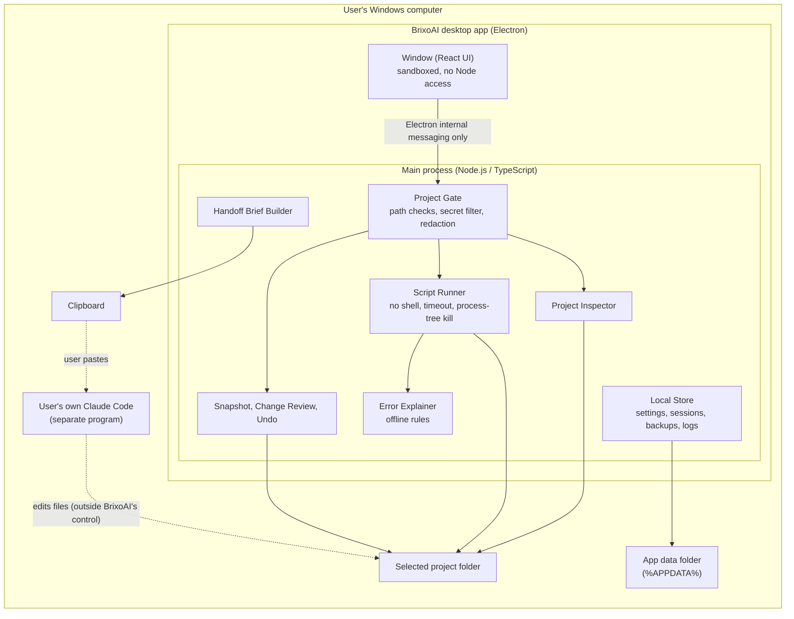
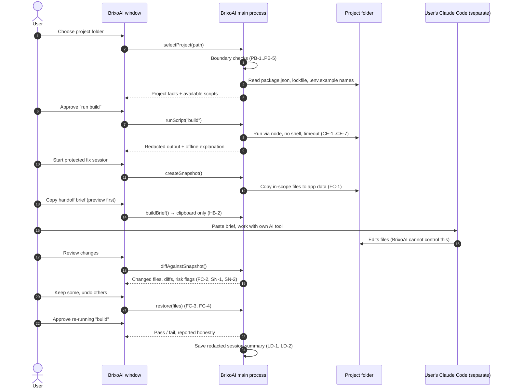

# BrixoAI — Architecture (Planning v3)

**Status:** Proposed MVP architecture, last updated 2026-10-29. **No component is implemented.** The direction is a local-first Windows desktop app with Electron, React, Vite and TypeScript and no mandatory WSL2 [Decision DEC-04]. It contains **no built-in AI** [Decision DEC-06]. Labels are defined in [DECISIONS.md](./DECISIONS.md).

This replaces the earlier hosted design (web app on Netlify, Supabase database, paired local helper). That design isn't needed for a local-first MVP and would add cost and complexity ([DECISIONS.md §2](./DECISIONS.md#2-status-of-the-earlier-decisions-round-1-recorded-2026-10-25), D10).

---

## 1. The big picture in plain English

BrixoAI is **one program on the user's Windows computer**:
- no website, server, database service or account;
- it connects to nothing on the internet;
- it looks at one project folder the user picks, runs only the checks the user approves, keeps backups, shows exactly what changed, and can put things back.

When the user wants AI help, they open **their own** Claude Code (or another AI tool) themselves. BrixoAI gives them a safe summary to paste, then reviews whatever that tool changed.

## 2. Component diagram

## 3. Components and responsibilities

| Component | Responsibility | Must not | Key requirements ([SECURITY.md](./SECURITY.md)) |
|---|---|---|---|
| **Window (renderer)** | Shows state, collects choices and approvals | Access files, run commands or hold secrets. It has no Node.js access | WN-3 |
| **Project Gate** | The single choke point for every file read, file write and command. Enforces the folder boundary, blocks secret files and redacts output | Be bypassable: every other component goes through it | PB-1 to PB-5, SE-1, SE-2 |
| **Project Inspector** | Reads `package.json`, version requirements, lockfile presence, expected env-variable **names**. Never runs project code | Read secret contents. Run git without resolving U7 | SE-1 |
| **Script Runner** | Runs one approved `package.json` script: no shell, minimal environment, timeout, cancel kills the whole process tree, output captured and redacted | Run arbitrary commands. Pass BrixoAI's own environment | CE-1 to CE-7 |
| **Error Explainer** | Matches captured output against versioned offline rules. Returns a plain-English explanation, likely files and suggested checks, or "not recognised" | Guess or fabricate an explanation | — |
| **Snapshot, Change Review, Undo** | Snapshots before a protected session, detects changes, shows diffs, flags risky changes, restores exactly | Change project files without an explicit user action | FC-1 to FC-5, SN-1 to SN-4 |
| **Handoff Brief Builder** | Builds a redacted brief for the user to copy into their own AI tool | Send anything over the network. Include secret contents | HB-1 to HB-3, NP-1 |
| **Local Store** | Settings, session summaries, snapshots, audit log; 30-day retention; delete and export | Use any cloud service | LD-1 to LD-4 |

## 4. How a session flows

**Session states** [Recommendation]: `no_project` → `project_selected` → `error_captured` → `protected_session_active` → `changes_reviewed` → `verified_pass` | `verified_fail` | `not_verified` → `closed`.

## 5. Local-first and privacy
- **Nothing leaves the computer** through BrixoAI (NP-1). The only data that can leave is what the user copies into their own tools, or network access by an approved command such as `npm install`.
- Because BrixoAI uploads nothing, the earlier per-task upload consent ([DECISIONS.md](./DECISIONS.md) D8) reduces to clear warnings at those two points.

## 6. Windows without WSL2
- [Verified 2026-10-25] Claude Code itself runs on native Windows 10 1809+ (PowerShell or Git Bash), but **its command sandbox is not supported on native Windows** ([setup docs](https://code.claude.com/docs/en/setup)). That's relevant because the user's external AI tool runs unsandboxed. BrixoAI's safety net doesn't depend on that sandbox.
- [Recommendation] BrixoAI handles Windows specifics in the Project Gate and Script Runner:
  - path normalisation, device names, junctions;
  - running npm through `node` instead of `cmd.exe` (U4);
  - Job Objects for process-tree cleanup;
  - long paths and file locks.
- [Recommendation] Electron includes its own Node.js runtime, so BrixoAI itself doesn't need Node installed. **Running the user's project does** need Node.js and npm installed, as it would without BrixoAI.

## 7. AI integration status (summary)
Full details and sources are in [INTEGRATIONS.md](./INTEGRATIONS.md).

| Path | Status |
|---|---|
| No built-in AI; the user runs their own Claude Code separately | **Chosen for the MVP** [Decision DEC-06] |
| Claude Agent SDK with an API key | **Excluded.** Requires API billing (DEC-05) |
| BrixoAI using the owner's subscription inside the app | **Not permitted** for third-party products per Anthropic's terms [Verified 2026-10-25] |
| BrixoAI launching or driving the user's own unmodified Claude Code | **Blocked** until Anthropic confirms in writing (U1, P-1) |

## 8. Designed now vs later

| Designed now | Deliberately later |
|---|---|
| Project Gate, Script Runner, snapshot/undo, redaction, local store, no-network rule | Built-in AI, accounts and sign-in, cloud sync, GitHub, deploys, plugins, multi-agent, auto-updates, macOS/Linux, a visual design |
| Clean boundary: every file and command operation goes through the Project Gate. That's what a future AI integration would call, so no plug-in abstraction is needed now | Engine or provider abstraction layers (add only when a second option is actually approved) |

## 9. Open technical questions

| ID | Question | How to resolve | Blocks |
|---|---|---|---|
| U1 | Does Anthropic permit BrixoAI to launch or drive the user's **own unmodified** Claude Code with their own subscription? The terms contain both a permission ("an end user signing in to the unmodified Claude Code binary") and restrictions on third-party products. | Written answer from Anthropic (owner decision P-1). Until then: blocked | Any in-app AI |
| U2 | How much real-world coverage can offline rule-based explanations achieve? | Measure against the test collection | Value of step 4 |
| U3 | Reliable change detection while an external tool edits files (snapshot comparison vs file watching; Windows file locking) | M3 spike on Windows | SN-1 |
| U4 | Running npm scripts on Windows without a shell: finding npm's JavaScript entry point across npm versions, and confirming Node's current rules for `.cmd` files | M2 spike on Windows; check Node/Electron release notes | CE-2 |
| U5 | Packaging the `koffi` native library in Electron on Windows (only if the Rakazo Job Object code is adopted) | M2 spike | CE-3 approach |
| U6 | The exact app data folder location and its default Windows permissions | Check the Electron docs and test | LD-1 |
| U7 | Running `git` in an untrusted project can execute commands configured in that project's git settings (for example a filesystem-monitor hook) | Research. Default: no git features in the first prototype (P-6) | Git features |
| U8 | Snapshot size and speed on large projects; the right exclusions | Measure on the test collection | FC-1 |
| U9 | A $0 code-signing route. SignPath Foundation's free OSS signing reportedly needs a public repository, which conflicts with DEC-12 for now | Revisit with P-3 | WN-5 |
| U10 | Distributing builds to testers from a private repository (GitHub Releases are visible only to people with access) | Check GitHub docs; give testers access or share builds directly | Prototype test |
| U11 | Whether walking testers through their own projects fits "ordinary, individual usage" if the owner's subscription were used | Avoid the question: testers use their own AI tools | Validation plan |
| U12 | Windows on ARM support | Later | — |
| U13 | Automated Electron UI testing and staying within the private-repo CI quota | Evaluate in M4 | Test plan |
