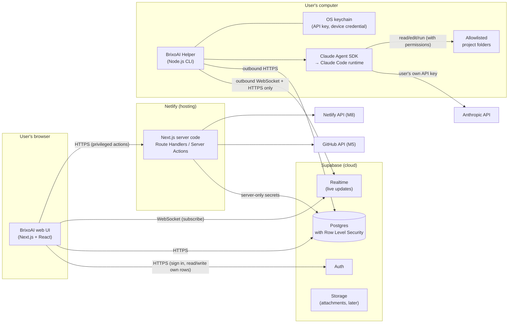
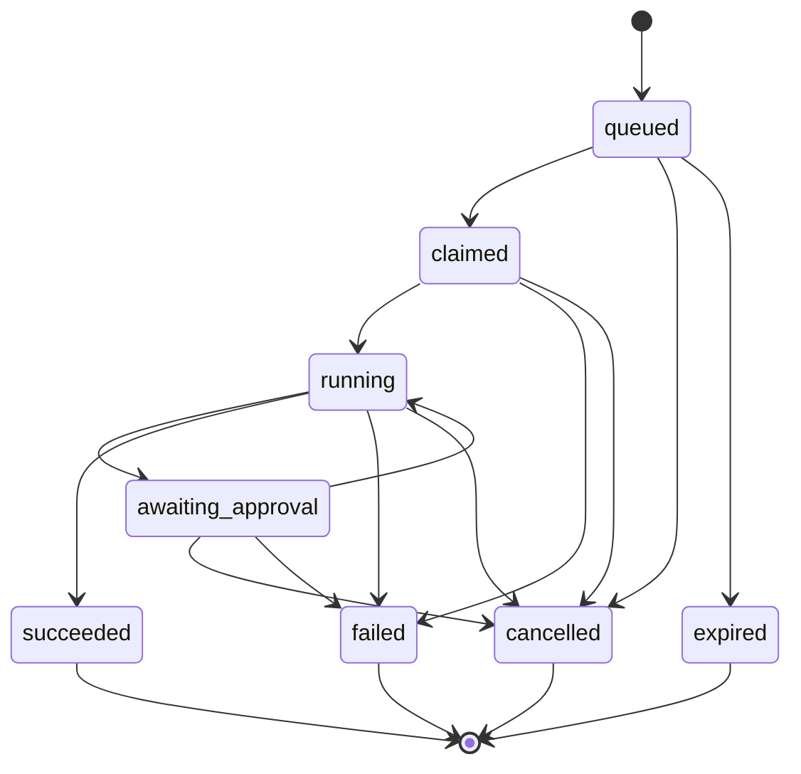
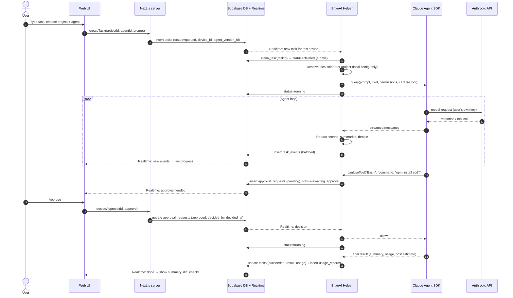

# BrixoAI — Architecture (Planning v2)

**Status:** Proposed. No component described here is implemented. Labels (**Verified**, **Needs verification**, **Proposed**, **Unknown**) are explained in [PRODUCT.md](./PRODUCT.md).

This document refines [../ARCHITECTURE.md](../ARCHITECTURE.md) (the earlier conceptual architecture). The main change is that **in the MVP, the "isolated execution worker" is the BrixoAI Helper running on the user's own computer**, not a cloud worker. That change needs your approval (see [README.md](./README.md#decisions-that-need-your-approval)).

---

## 1. The big picture in plain English

BrixoAI has four parts:

1. **Web app (the "front of house").** The website you open in a browser. It shows projects, tasks, progress and approval buttons. It never runs AI coding work itself.
2. **Supabase (the "order board and filing cabinet").** A hosted database plus login system plus live-update channel. The web app writes "new task" onto the board; the helper sees it instantly; progress gets written back; the web app shows it live.
3. **BrixoAI Helper (the "kitchen").** A small program on *your* computer. It only touches folders you allow. It runs Claude Code to do the actual work and asks you (through the web app) before risky actions.
4. **External services.** Anthropic (the AI model), and later GitHub, Netlify and MCP tools.

A key safety idea: **the helper only makes outgoing connections.** Nobody on the internet can connect *into* your computer through BrixoAI. The helper reaches out to Supabase and listens for its own tasks.

## 2. System diagram

## 3. Component boundaries and responsibilities

| Component | Runs where | Responsible for | Must NOT do |
|---|---|---|---|
| **Web UI** (React components) | User's browser | Display state, collect input, show approvals, subscribe to live updates | Hold provider secrets; claim an action happened before the database/helper confirms it |
| **Next.js server code** | Netlify serverless functions | Privileged operations: helper pairing, GitHub App token exchange (M5), Netlify API calls (M8), encrypting/decrypting integration tokens | Run AI agents, run repository code, hold long-running connections, store user API keys |
| **Supabase Auth** | Supabase | User sign-in, sessions | — |
| **Supabase Postgres + RLS** | Supabase | The source of truth for projects, agents, tasks, events, approvals. Row Level Security makes each user see only their own rows | Store Anthropic API keys, absolute local paths or full source code |
| **Supabase Realtime** | Supabase | Push changes to the browser and the helper instantly | Be relied on as the only record (the database is the record) |
| **BrixoAI Helper** | User's computer | Pairing, folder allowlist, claiming tasks, running the Agent SDK, relaying approvals, cancellation, redacting secrets from events, heartbeats | Access non-allowlisted folders; send API keys or raw file contents to BrixoAI's cloud by default; listen on network ports |
| **Claude Agent SDK / Claude Code runtime** | User's computer, started by the helper | The agent loop: plan, call tools, edit files, run commands | Run with `bypassPermissions` in BrixoAI's default configuration |
| **Future cloud worker** | Cloud sandbox (Later) | Run tasks when the laptop is off | Share infrastructure or credentials with the web app |

> **Term — Row Level Security (RLS):** a Postgres feature where the database itself checks "is this row yours?" on every read and write. Even if the web app has a bug, the database refuses to leak someone else's data.

> **Term — Serverless function:** code that runs on demand for each request and then stops. Cheap and simple, but not suited to long-running jobs. This is why agents do not run on Netlify.

## 4. How a task moves through the system

### 4.1 Task states (canonical list used across all planning docs)

| State | Meaning | Who sets it |
|---|---|---|
| `queued` | Task created and waiting for a helper | Web (via server code) |
| `claimed` | A helper has taken the task and is preparing it | Helper (atomic `claim_task` database function) |
| `running` | The agent is working | Helper |
| `awaiting_approval` | Paused; an approval request is pending | Helper |
| `succeeded` | The agent finished its workflow without error | Helper |
| `failed` | Something went wrong; `failure_reason` is recorded | Helper or server (e.g. helper lost) |
| `cancelled` | The user cancelled, and the helper confirmed it stopped | Helper (or server if the helper never picked the task up) |
| `expired` | No helper claimed it within the time limit (default proposal: 10 minutes) | Server (scheduled cleanup or on next read) |

Allowed transitions:

**Why fewer states than the earlier docs?** The earlier docs listed workflow-specific states (`analyzing`, `checking`, `diagnosing`, `fixing`, `testing`, `proposing`, `pull_request_open`). Those describe *what the agent is doing*, which varies by task. We record them as **phase events** in `task_events` (for example `{type: "phase", phase: "testing"}`) instead of task states. The state machine stays small and the same for every task. **`succeeded` means the agent's workflow finished, not that the code is bug-free.** Check results are shown separately.

### 4.2 Happy path with an approval

### 4.3 Cancellation

1. The user clicks **Cancel**. Server code sets `tasks.cancel_requested_at = now()`.
2. If the task is still `queued`, the server immediately sets `cancelled`.
3. Otherwise the helper receives the change via Realtime and calls the SDK's `interrupt()` (Verified to exist). Any pending approval is resolved as **deny**. If the agent does not stop within a grace period (proposal: 10 s), the helper terminates the runtime process.
4. The helper writes `cancelled` and a final event saying which step was interrupted. A command that was mid-run is recorded as killed (Claude Code records this — Verified for `-p` runs on SIGTERM).
5. **What cancel does not undo:** file edits already written. The UI says so plainly and shows the diff, so the user can discard changes with git.

### 4.4 Errors, timeouts and the helper going away

| Situation | Behaviour |
|---|---|
| Helper offline when the task is created | UI shows "Helper offline" (from `devices.last_seen_at` heartbeat, proposed every 20 s). Task stays `queued`, then `expired` after the limit |
| Helper crashes mid-task | Heartbeat stops. After 2 minutes without a heartbeat for a `running`/`awaiting_approval` task, the server marks it `failed` with reason `helper_lost`. On restart, the helper reports orphaned local runs and does **not** silently resume them |
| Approval not answered | Default timeout proposal: 15 minutes, then **deny**. The agent is told it was denied and may continue without that action |
| Task wall-clock limit | Default proposal: 30 minutes per task, configurable per agent within a hard maximum. On limit: interrupt, mark `failed` with reason `time_limit` |
| Budget limit | Per-task maximum estimated spend (CLI has `--max-budget-usd` — Verified. SDK option name needs verification). On limit: stop, `failed` with reason `budget_limit` |
| Turn limit | Per-task maximum agent turns (proposal: 50). Option name to be verified in the SDK |
| Anthropic API errors | The runtime retries retryable errors itself (Verified: it emits `api_retry` events). The helper surfaces those events as progress, not failures |
| Realtime disconnect | supabase-js reconnects automatically. The helper also re-reads pending tasks/approvals on reconnect, so nothing is missed |

**Retries and side effects.** BrixoAI does **not** automatically retry a whole failed task, because a retry could repeat side effects (commits, installs). The user can click **Run again**, which creates a *new* task linked to the old one.

## 5. Local execution vs cloud execution

| | **Local (MVP)** | **Cloud worker (Later)** |
|---|---|---|
| Where code runs | User's computer, in allowlisted folders | An isolated cloud sandbox per task or per user |
| Who pays for compute | User (their own computer) | Someone pays per minute: the user or BrixoAI. Business decision |
| Works with laptop closed | No | Yes |
| Access to the user's private local files | Yes, only allowlisted folders | Only what is uploaded or cloned (e.g. from GitHub) |
| Isolation | Claude Code permission rules + BrixoAI approvals + the Claude Code command sandbox on macOS/Linux/WSL2 (Verified). Weaker than a VM | Strong: a separate VM or container with no access to the user's machine |
| AI credential | User's key in the local keychain | Must be supplied to the sandbox securely. Each user's own credential, as Anthropic's terms require |
| Best for | Vibe coding on real projects; beginners; zero hosting cost | Schedules, long jobs, business automations |

Every task records `execution_target` (`local_helper` now, `cloud_worker` later). The same task, event and approval tables serve both, so the UI does not change when cloud execution arrives.

## 6. Claude authentication modes

This is the most important constraint found during research.

**Verified facts** (from Anthropic's Claude Code legal and Agent SDK docs, October 2026):
- Third-party developers may **not** offer Claude.ai login in their own apps, or route requests through Free/Pro/Max plan credentials on behalf of their users. They may not collect, store or intermediate Claude.ai credentials or session tokens.
- Developers building products with the Agent SDK should use **API key** authentication (Claude Console) or a supported cloud provider (Amazon Bedrock, Google Cloud, Microsoft Foundry).
- Products that run Claude Code may not pay for, resell or intermediate Claude usage. **Each end user must use their own** API key, subscription credentials or cloud-provider credential, billed to them.
- An end user signing in to the **unmodified** Claude Code binary with their own subscription is not prevented, including where a platform hosts Claude Code.
- "Advertised usage limits for Pro and Max plans assume ordinary, individual usage of Claude Code and the Agent SDK."

**Proposed modes**

| Mode | How it works | Status |
|---|---|---|
| **Mode A — Your own Anthropic API key** (recommended default) | The user creates a key in the Claude Console and pastes it **into the helper on their own computer** (never into the web app, chat or a file in a repo). The helper stores it in the OS keychain and passes it to the Agent SDK as an environment variable for the child process only. Billing is pay-as-you-go to the user | **Clearly permitted.** MVP default |
| **Mode B — Your own Claude Code login** | The user installs the official Claude Code CLI and signs in themselves through Anthropic's own flow. The helper runs that unmodified CLI as a subprocess (`claude -p --output-format stream-json`) without touching credentials | **Needs verification with Anthropic before we advertise it.** The legal page appears to allow it, but the Agent SDK page says third parties may not "offer claude.ai login or rate limits" for SDK-built agents. Proposed: build Mode A only; ask Anthropic (contact sales) about Mode B in writing |
| **Mode C — Cloud provider credentials** (Bedrock / Google Cloud / Foundry) | The user configures their own provider credentials locally | Supported by Claude Code (Verified). **Later** — useful for businesses |

What BrixoAI must never do: show a "Sign in with Claude" button, ask for a Claude password, copy OAuth tokens, or proxy model requests through BrixoAI servers using one shared key.

## 7. What runs where

| Concern | Browser | Next.js server (Netlify) | Supabase | Helper (local) | Future cloud worker |
|---|---|---|---|---|---|
| Sign-in UI | ✅ | | Auth ✅ | | |
| Read own projects/tasks/events | ✅ (RLS) | | ✅ | ✅ (RLS, device-scoped) | ✅ |
| Create task / cancel / decide approval | Calls server | ✅ validates + writes | ✅ | | |
| Pairing code issue + approval | Enter code | ✅ | ✅ stores hashed | Shows code | |
| GitHub App private key, Netlify tokens | | ✅ (env vars / encrypted) | Encrypted at rest | | |
| Anthropic API key | | | | ✅ OS keychain | Injected per job (Later) |
| Absolute folder paths | | | | ✅ local config only | |
| Running Claude Code | | | | ✅ | ✅ |
| Running repository commands (`npm test`) | | ❌ never | | ✅ with permissions | ✅ |
| Scheduling (Later) | | | `pg_cron` enqueues (Needs verification on free tier) | Executes if online | Executes |

## 8. Recommended technology choices (summary)

Full comparison and costs in [TECH_STACK.md](./TECH_STACK.md).

| Area | Choice | Main reason | Main alternative |
|---|---|---|---|
| Web framework | Next.js 16 (App Router) + React + TypeScript | Your preference; huge ecosystem; Claude Code knows it well | Vite + React SPA (simpler, but no server code) |
| UI | Tailwind CSS + shadcn/ui | Copy-in components you own; easy to restyle to Stitch | Radix primitives directly |
| Database, auth, realtime | Supabase | One service covers DB + auth + realtime + storage; free tier; open source | Firebase (not SQL, not open source); Neon + Clerk + Pusher (three vendors) |
| Hosting | Netlify | Your preference; free tier allows commercial use (Needs verification of the current terms) | Cloudflare Pages/Workers; Vercel (Hobby plan is non-commercial — Needs verification) |
| Local helper | Node.js LTS CLI in TypeScript | Same language as the web app; the official Agent SDK has a TypeScript package (Verified) | Python helper (also has an SDK); Tauri/Electron desktop app (Later) |
| Coding engine | Claude Agent SDK (`@anthropic-ai/claude-agent-sdk`) | Official, supports permissions, `canUseTool`, `interrupt()`, sessions, hooks, MCP (Verified) | Spawning `claude -p` (Mode B); Anthropic Client SDK with a home-made tool loop (far more work, less safe) |
| Monorepo | npm workspaces: `apps/web`, `apps/helper`, `packages/shared` | Ships with Node; no extra tool to install | pnpm workspaces (faster, one more install) |
| Validation | Zod schemas in `packages/shared` | Web, server and helper all agree on event and task shapes | Hand-written types (drift risk) |
| Tests | Vitest (unit), Playwright (end-to-end), Supabase CLI local stack for RLS tests | Standard, free | Jest; Cypress |

## 9. Key decisions and trade-offs

1. **Local-first execution.** *Pro:* near-zero hosting cost, the user's code stays on their machine, works with private local projects. *Con:* the laptop must be on; isolation is weaker than a cloud VM; the helper must support three operating systems.
2. **Supabase Realtime as the message bus** instead of a custom WebSocket server. *Pro:* no server to run; works with serverless hosting; RLS-aware. *Con:* free-tier limit of 200 concurrent connections and 100 messages/second (Verified from Supabase docs), so the helper must batch and throttle events. Vendor coupling.
3. **Server code only for privileged actions.** Most reads and writes go browser → Supabase directly with RLS. That keeps Netlify function usage (and credits) low.
4. **Agent SDK over raw CLI.** *Pro:* typed messages, approval callback, interrupt, hooks. *Con:* SDK policy requires API-key auth (Mode A).
5. **Agents are configurations, not running processes.** Matches the earlier PRD. Each task snapshots the agent configuration (`agent_version_id`), so edits never change a running task.
6. **No microservices.** One web app, one helper, one shared package, one database.

## 10. Open unknowns

| # | Unknown | Why it matters | Resolve in |
|---|---|---|---|
| U1 | How the helper gets a **device-scoped Supabase token** for Realtime and database writes. Options: (a) server mints a short-lived JWT for the device using Supabase's JWT signing keys / third-party auth support; (b) the helper does its own Supabase sign-in (PKCE flow in the browser) and stores the session in the keychain; (c) fallback: all helper writes go through Next.js API routes (costs Netlify credits) | Security of the helper connection and cost | M2 spike |
| U2 | Mode B (own Claude Code login via the unmodified CLI) acceptability | Whether subscription users can use BrixoAI without an API key | Written answer from Anthropic before M4 |
| U3 | Exact TypeScript SDK option names for turn limits, budget limits, effort, model listing and sandbox settings | Implementation detail | M1 |
| U4 | Best way to pass images/screenshots to the agent through the SDK | Screenshot features | M5–M6 |
| U5 | Supabase free tier: `pg_cron` availability and the Data API grants change for new projects | Scheduling; setup steps | M2 |
| U6 | Netlify credit consumption per function call and per deploy | Hosting cost of the web app | M2 (measure) |
| U7 | Whether Stitch has a public API | Design import automation | Later |
| U8 | Windows native support level for the helper (no command sandbox) | Safety on Windows | M1 (decide: WSL2-only vs best-effort native with stricter approvals) |
