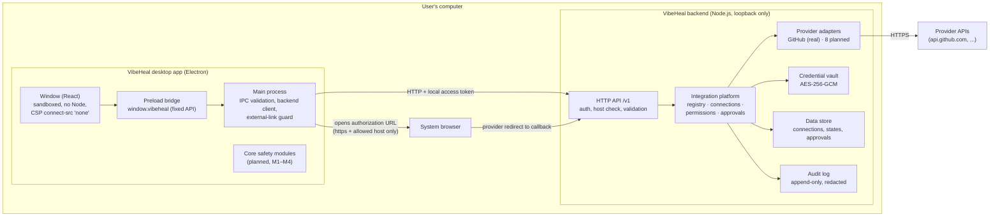
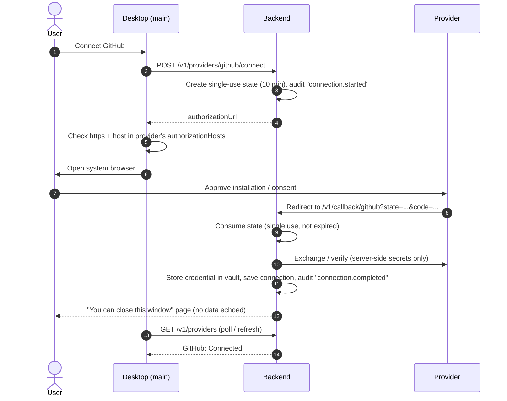

# VibeHeal — Architecture (Planning v4)

**Status:** Last updated 2026-10-31. This version adds the **backend-managed integration marketplace** [Decision DEC-17, DEC-18]. Labels are defined in [DECISIONS.md](./DECISIONS.md).

**What exists in code (2026-10-31):**
- the integration platform (IM1) and the GitHub adapter (IM2) in `server/`, `desktop/` and `shared/`, described in §4 to §7;
- automated tests for those parts.

**What does not exist yet:**
- the core safety-workflow components (§3: Project Gate, Script Runner, Snapshot and Undo, and the others);
- any hosted deployment.

**History:** v3 (2026-10-29) was a single local desktop app with no backend, no ports and no network. Its core components are kept below. Its "no network, no ports, no credentials" rules are superseded for integration features only ([DECISIONS.md §4](./DECISIONS.md#4-round-3-backend-managed-integration-marketplace-recorded-2026-10-31)). The v3 text is preserved in git history and in [The-enlit-dev/VibeHealAI#1](https://github.com/The-enlit-dev/VibeHealAI/pull/1).

---

## 1. The big picture in plain English

VibeHeal has **two programs**:
1. **The desktop app** on the user's computer. It shows the marketplace, and later the broken-project workflow: inspect, explain, back up, review, undo, verify.
2. **The VibeHeal backend.** A small server that holds provider credentials and talks to GitHub, Vercel and the other providers for the desktop app.
   - **Today it runs only on the developer's own computer** and listens only on `127.0.0.1`.
   - It is designed to be hosted later, but **it is not deployed** (DEC-18, DEC-22).

The desktop app never sees provider tokens or app secrets. It asks the backend things like "list my GitHub repositories", and the backend answers with plain data.

## 2. Component diagram

## 3. Core safety-workflow components (planned, unchanged from v3)

These are still the centre of the product [Decision DEC-16]. **None is implemented yet.** They run in the desktop main process and work without the backend.

| Component | Responsibility | Key requirements ([SECURITY.md](./SECURITY.md)) |
|---|---|---|
| Project Gate | The single choke point for every file read, file write and command in the selected project folder | PB-1 to PB-5, SE-1, SE-2 |
| Project Inspector | Reads `package.json`, version requirements, lockfile presence and expected env-variable names | SE-1 |
| Script Runner | Runs one approved `package.json` script: no shell, timeout, process-tree kill | CE-1 to CE-7 |
| Error Explainer | Offline rules that explain common errors | — |
| Snapshot, Change Review, Undo | Backs up before a fix session, shows diffs, restores exactly | FC-1 to FC-5, SN-1 to SN-4 |
| Handoff Brief Builder | A redacted brief the user copies into their own AI tool | HB-1 to HB-3 |
| Local Store | Settings, sessions, snapshots, local audit log | LD-1 to LD-4 |

### 3.1 How a core session flows (planned, from v3)

**Session states** [Recommendation]: `no_project` → `project_selected` → `error_captured` → `protected_session_active` → `changes_reviewed` → `verified_pass` | `verified_fail` | `not_verified` → `closed`.

**How integrations will feed the workflow (later):**
- The handoff brief and the project view can include **context** from connected providers: the GitHub repository, branch and recent commits; the latest Vercel or Netlify deployment status; Figma frames; and so on.
- Each piece of context is fetched through the backend's read-only capabilities and redacted before display.
- The workflow must keep working when nothing is connected.

## 4. Integration platform

Code: `server/integrations/`. Every provider plugs into the same parts, so adding one never requires changes to the marketplace UI or the connection manager.

| Part | File | Responsibility |
|---|---|---|
| **Provider metadata** | `shared/providers.ts` (types), `server/providers/*/metadata.ts` | id, name, category, description, permissions (with access level), capabilities, authorization hosts, docs links, implementation status |
| **Adapter interface** | `server/integrations/adapter.ts` | `ProviderAdapter`: `metadata`, `configuration()`, `beginConnect()`, `completeConnect()`, `revoke()`, `capabilities` |
| **Provider registry** | `server/integrations/registry.ts` | Validates and registers adapters: unique ids, capabilities only use declared permissions, planned adapters cannot expose capabilities |
| **Connection manager** | `server/integrations/connection-manager.ts` | Starts authorization (single-use, expiring `state`), completes callbacks, stores credentials in the vault, disconnects and revokes, tracks status |
| **Permission manager / action authorizer** | `server/integrations/permission-manager.ts` | Per-action checks: connection is connected; granted permissions cover the capability; non-read capabilities need a matching, unexpired, single-use approval |
| **Availability** | `server/integrations/availability.ts` | Computes the label shown in the UI (§4.1) |
| **Errors** | `server/integrations/errors.ts` | `IntegrationError` with safe codes and messages; provider response bodies are never passed through |
| **Credential vault** | `server/credentials/` | `CredentialVault` interface; `EncryptedFileVault` for local development (§6) |
| **Data store** | `server/storage/` | Repository interfaces; JSON-file implementation for local development, replaceable with a database when hosted |
| **Audit log** | `server/storage/audit-log.ts` | Append-only JSON Lines; every entry passes through redaction |

### 4.1 Availability states

| Label | Meaning | How it's computed |
|---|---|---|
| **Coming soon** | Only metadata and a planned adapter exist. Connect is disabled | `implementation: "planned"` |
| **Not configured** | A real adapter exists, but the backend is missing required configuration (for example GitHub App settings). The UI lists the missing setting **names** | `configuration().configured === false` |
| **Available** | Real adapter and configuration present; not connected | default |
| **Connected** | A connection exists with status `connected` | connection record |
| **Error** | A connection exists but failed (for example authorization was revoked on the provider's side, or verification failed) | connection status `error` |

### 4.2 Connection lifecycle

**Disconnect:** the desktop app calls `DELETE /v1/connections/:id`. The backend:
1. calls the adapter's `revoke()` (best effort, with the result recorded);
2. deletes the vault entry;
3. deletes the connection record;
4. writes an audit entry.

If revocation at the provider fails, the local credential is **still deleted**, and the UI says the provider-side revocation must be finished manually.

### 4.3 Capabilities and per-action authorization
- A capability is one named, typed action, such as `github.repositories.list`. It declares:
  - its required permissions;
  - its access level: `read`, `write` or `sensitive`;
  - an input validator;
  - an output mapper that returns only whitelisted fields.
- `POST /v1/connections/:id/actions/:capability` runs one. Every call is authorized individually and audited, whether allowed or denied.
- `write` and `sensitive` capabilities need an approval:
  1. `POST /v1/approvals` creates a pending approval bound to (connection, capability, SHA-256 of the input).
  2. The user confirms in the desktop app (`POST /v1/approvals/:id/approve`).
  3. The approval is used once and expires after 5 minutes.
- **No write or sensitive capability is implemented yet** (DEC-21). The gate is built and tested so the first one can't skip it.

### 4.4 Third-party plugins (future, not built)
The registry accepts only adapters compiled into the backend. A future third-party plugin system would:
- add signed, declarative manifests;
- run plugin code out of process with its own permissions;
- add a review process.

None of this exists, and no code is downloaded or executed from outside the repository (DEC-17).

## 5. Backend API

Code: `server/http/`. It uses Node.js's built-in `http` module, so there is no framework dependency ([TECH_STACK.md](./TECH_STACK.md)). Every route except `/v1/health` and the provider callback requires `Authorization: Bearer <local access token>`.

| Method | Path | Purpose |
|---|---|---|
| GET | `/v1/health` | Liveness (no auth, no details) |
| GET | `/v1/providers` | Catalog: all providers with availability |
| GET | `/v1/providers/:providerId` | Details, permissions, capabilities, missing configuration names, connection |
| POST | `/v1/providers/:providerId/connect` | Start authorization; returns `authorizationUrl` |
| GET | `/v1/callback/:providerId` | Provider redirect target (protected by single-use `state`) |
| GET | `/v1/connections` | Connections (no credentials) |
| DELETE | `/v1/connections/:connectionId` | Disconnect and revoke |
| POST | `/v1/connections/:connectionId/actions/:capabilityId` | Run one capability (`{ input, approvalId? }`) |
| POST | `/v1/approvals` | Create a pending approval for a non-read capability |
| POST | `/v1/approvals/:approvalId/approve` | Confirm a pending approval |
| GET | `/v1/activity` | Recent audit entries (redacted) |

The API's security rules are BK-1 to BK-8 in [SECURITY.md](./SECURITY.md#212-backend-and-api-bk).

## 6. Credentials and data

- **Vault:** `EncryptedFileVault` encrypts each credential with **AES-256-GCM** (Node.js `crypto`).
  - It uses a random 96-bit IV per record and a 256-bit key from `VIBEHEAL_ENCRYPTION_KEY`.
  - Additional authenticated data (AAD) binds each ciphertext to its credential id and provider, so records can't be swapped.
  - Each record stores a key id so the key can be rotated later.
  - The file is written atomically with owner-only permissions where the OS supports them.
- **Secret values in memory** are wrapped in a `Secret` type. Its `toString`, `toJSON` and `inspect` all print `[REDACTED]`, so an accidental log line can't leak them.
- **Persistent data** (connections, authorization states, approvals) is stored as JSON files in `VIBEHEAL_DATA_DIR` (default `./.vibeheal-data/`, git-ignored). It sits behind repository interfaces, so a database can replace it when the backend is hosted.
- **GitHub specifically:** VibeHeal stores only the installation id.
  - Short-lived (1-hour) installation tokens are minted on demand with the App's private key and cached in memory only.
  - No long-lived GitHub user token is kept.

Details: [DATA_MODEL.md](./DATA_MODEL.md).

## 7. Desktop app

Code: `desktop/`.
- **Renderer:** React UI for the marketplace.
  - No Node.js, context isolation on, sandboxed.
  - Strict content security policy with `connect-src 'none'`: the window cannot make network requests itself.
- **Preload:** exposes a small, fixed `window.vibeheal` API through `contextBridge`. It exposes no generic IPC.
- **Main process:**
  - validates every IPC argument;
  - calls the backend with the local access token, which the renderer never sees;
  - opens authorization URLs in the system browser only if they use `https` and a host listed in that provider's `authorizationHosts`;
  - blocks in-window navigation and new windows.

## 8. Hosting later (designed for, not done)

- **Configuration:** everything comes from environment variables, validated at startup.
- **Network binding:** the backend refuses to listen on a non-loopback address unless `VIBEHEAL_ALLOW_NON_LOOPBACK=true` is set explicitly, which is meant for a future deployment behind TLS.
- **Storage and keys:** storage and the vault are interfaces. Postgres and a cloud KMS would be new implementations, not rewrites (P-10, P-12).
- **Identity:** hosted identity is pending (P-9). Hosting must not happen before that decision and a security review.

## 9. Open technical questions

| ID | Question | How to resolve | Blocks |
|---|---|---|---|
| U1 | Does Anthropic permit VibeHeal to launch or drive the user's **own unmodified** Claude Code with their own subscription? The terms contain both a permission ("an end user signing in to the unmodified Claude Code binary") and restrictions on third-party products. | Written answer from Anthropic (owner decision P-1). Until then: blocked | Any in-app AI |
| U2 | How much real-world coverage can offline rule-based explanations achieve? | Measure against the test collection | Value of step 4 |
| U3 | Reliable change detection while an external tool edits files (snapshot comparison vs file watching; Windows file locking) | M3 spike on Windows | SN-1 |
| U4 | Running npm scripts on Windows without a shell: finding npm's JavaScript entry point across npm versions, and confirming Node's current rules for `.cmd` files | M2 spike on Windows; check Node/Electron release notes | CE-2 |
| U5 | Packaging the `koffi` native library in Electron on Windows (only if the Rakazo Job Object code is adopted) | M2 spike | CE-3 approach |
| U6 | The exact app data folder location and its default Windows permissions | Check the Electron docs and test | LD-1 |
| U7 | Running `git` in an untrusted project can execute commands configured in that project's git settings (for example a filesystem-monitor hook) | Research. Default: no git features in the first prototype (P-6) | Git features |
| U8 | Snapshot size and speed on large projects; the right exclusions | Measure on the test collection | FC-1 |
| U9 | A $0 code-signing route. SignPath Foundation's free OSS signing reportedly needs a public repository, which conflicts with DEC-12 for now | Revisit with P-3 | WN-5 |
| U10 | Distributing builds to testers from a private repository (GitHub Releases are visible only to people with access) | Check GitHub docs; give testers access or share builds directly | Prototype test |
| U11 | Whether walking testers through their own projects fits "ordinary, individual usage" if the owner's subscription were used | Avoid the question: testers use their own AI tools | Validation plan |
| U12 | Windows on ARM support | Later | — |
| U13 | Automated Electron UI testing and staying within the private-repo CI quota | Evaluate in M4 | Test plan |
| U14 | GitHub App flow details: the `state` round-trip on the installation URL, "Request user authorization (OAuth) during installation", and the exact permission each read endpoint needs | Check against docs.github.com. It was unreachable from the build environment on 2026-10-31, so these are **[Assumption]** | Live GitHub testing |
| U15 | Each remaining provider's official auth model, scopes, rate limits and data-handling terms | Review official docs before building each adapter (IM3, IM4) | IM3, IM4 |
| U16 | How the desktop app learns a connection finished (polling vs a push channel) | Polling for IM1; revisit when hosted | — |
| U17 | Encryption-key rotation procedure | Design with P-12 | Hosting |
