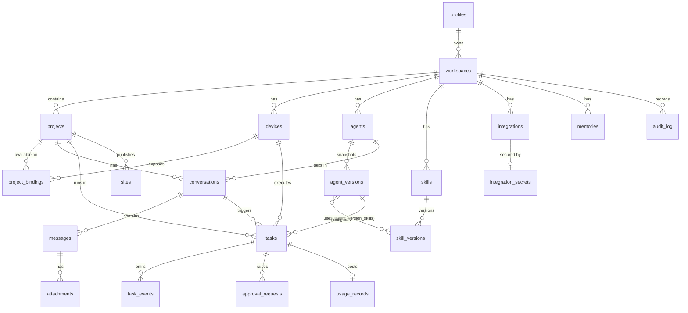

# BrixoAI — Data Model and API Design (Planning v2)

**Status:** Proposed. **No database, migration or API exists.** Real migrations will be written and reviewed during the milestones in [ROADMAP.md](./ROADMAP.md). Labels are explained in [PRODUCT.md](./PRODUCT.md).

> **Term — table:** like a spreadsheet tab in the database; each row is one item (one task, one project).
> **Term — foreign key:** a column that points to a row in another table (a task's `project_id` points to its project).
> **Term — RLS (Row Level Security):** database rules that decide which rows each signed-in user may see or change.

---

## 1. Core entities (plain English)

| Entity | What it is | Milestone |
|---|---|---|
| **Profile** | A user's display info (linked to the Supabase Auth user) | M2 |
| **Workspace** | The ownership boundary. One per user in the MVP; teams Later | M2 |
| **Project** | A piece of work: a local folder (bound on a device) and optionally a GitHub repo | M2 |
| **Device** | A paired BrixoAI Helper on a computer | M2 |
| **Device pairing** | A short-lived pairing request (user code + hashed device code) | M2 |
| **Project binding** | "Project X is available on device Y" (no path stored in the cloud) | M2 |
| **Agent** ("bot", "AI teammate") | A saved configuration: name, role instructions, model, tools, limits | M4 |
| **Agent version** | An immutable snapshot of an agent's configuration, used by tasks | M4 |
| **Conversation** | A thread of messages with an agent about a project | M4 |
| **Message** | One user or agent message in a conversation | M4 |
| **Attachment** | An uploaded file (screenshot, document) | M5+ |
| **Task** | One execution: prompt, target device, state, result, usage | M3 |
| **Task event** | One sanitised progress item for a task | M3 |
| **Approval request** | A pending or decided permission request | M3 |
| **Memory** | A remembered fact or preference, visible and editable | M7 |
| **Skill** / **Skill version** | Reusable instructions (`SKILL.md` content), versioned | M6 |
| **Integration** | A connection to GitHub, Netlify, an MCP server, etc. (metadata only) | M5+ |
| **Integration secret** | Encrypted token for an integration (server-only table) | M5+ |
| **Usage record** | Tokens and estimated cost for a task | M4 |
| **Audit log** | A record of approvals and external side effects | M3 |
| **Site** | A website linked to a project and a hosting provider | M8 |

## 2. Relationships diagram

## 3. Proposed tables

All tables get `id uuid primary key default gen_random_uuid()` and `created_at timestamptz default now()` unless noted. Every user-data table carries `workspace_id`, for simple, uniform RLS. Types are indicative.

### Identity and devices (M2)

| Table | Key columns |
|---|---|
| `profiles` | `id` (= `auth.users.id`), `display_name`, `avatar_url`, `onboarding_state jsonb` |
| `workspaces` | `owner_id → profiles`, `name` |
| `devices` | `workspace_id`, `name`, `platform` (`macos`/`linux`/`wsl`/`windows`), `helper_version`, `credential_hash`, `last_seen_at`, `sandbox_available bool`, `revoked_at` |
| `device_pairings` | `user_code` (unique, short), `device_code_hash`, `requested_name`, `requested_platform`, `status` (`pending`/`approved`/`consumed`/`expired`), `approved_by`, `expires_at`. Server-only access |

### Projects (M2)

| Table | Key columns |
|---|---|
| `projects` | `workspace_id`, `name`, `description`, `github_repo_full_name` (nullable, M5), `default_branch` (nullable), `trusted_settings bool default false` (user trusts the repo's `.claude/` config) |
| `project_bindings` | `project_id`, `device_id`, `folder_label` (e.g. "my-shop" — **not** the absolute path), `detected_stack jsonb` (e.g. `{"packageManager":"npm","framework":"next"}`, sanitised), `unique(project_id, device_id)` |

### Agents (M4)

| Table | Key columns |
|---|---|
| `agents` | `workspace_id`, `name`, `icon`, `description`, `current_version_id`, `status` (`active`/`paused`), `deleted_at` |
| `agent_versions` | `agent_id`, `version int`, `instructions text`, `model` (nullable = runtime default), `effort` (nullable), `allowed_tool_rules text[]` (scoped rules only), `limits jsonb` (time, turns, budget), `approval_policy jsonb`, `mcp_server_ids uuid[]` (M9). **Immutable** after insert |
| `agent_version_skills` | `agent_version_id`, `skill_version_id` (M6) |

### Conversations (M4)

| Table | Key columns |
|---|---|
| `conversations` | `workspace_id`, `project_id`, `agent_id`, `title`, `claude_session_id` (the runtime's session ID for resume; the session data itself stays on the device), `device_id` |
| `messages` | `conversation_id`, `workspace_id`, `role` (`user`/`agent`/`system`), `content text`, `task_id` (nullable) |
| `attachments` | `message_id`, `workspace_id`, `storage_path` (private Supabase Storage bucket), `mime_type`, `size_bytes` (M5+) |

### Tasks (M3)

| Table | Key columns |
|---|---|
| `tasks` | `workspace_id`, `project_id`, `conversation_id` (nullable), `agent_version_id` (nullable before M4), `device_id`, `execution_target` (`local_helper` / `cloud_worker`), `prompt text`, `status` (see §7), `failure_reason` (nullable enum-like text), `cancel_requested_at`, `claimed_at`, `started_at`, `finished_at`, `result_summary text`, `changed_files jsonb` (paths relative to project + line counts), `checks jsonb` (commands run + exit codes), `rerun_of` (nullable → tasks) |
| `task_events` | `task_id`, `workspace_id`, `seq int` (ordering), `type` (see §8), `payload jsonb` (sanitised, ≤ 8 KB), `created_at`. Insert-only |
| `approval_requests` | `task_id`, `workspace_id`, `tool_name`, `tool_input_summary jsonb` (sanitised), `risk` (`low`/`medium`/`high`), `status` (`pending`/`approved`/`denied`/`expired`/`cancelled`), `decided_by`, `decided_at`, `expires_at`, `remember_rule` (nullable scoped rule to add to the agent) |

### Memory, skills, integrations, usage, audit

| Table | Key columns | Milestone |
|---|---|---|
| `memories` | `workspace_id`, `project_id` (nullable = global), `agent_id` (nullable), `kind` (`preference`/`fact`/`summary`), `content text`, `source_task_id`, `pinned bool`, `deleted_at` | M7 |
| `skills` | `workspace_id` (null = built-in), `slug`, `name`, `description`, `enabled bool`, `source` (`builtin`/`user`/`github`), `source_url` | M6 |
| `skill_versions` | `skill_id`, `version int`, `content text` (the `SKILL.md`), `content_sha256`, `reviewed_by`, `reviewed_at`. Immutable | M6 |
| `integrations` | `workspace_id`, `provider` (`github`/`netlify`/`mcp`/…), `status` (`connected`/`error`/`revoked`), `external_account_id`, `external_account_name`, `scopes text[]`, `config jsonb` (non-secret, e.g. MCP server URL), `connected_at`, `revoked_at` | M5+ |
| `integration_secrets` | `integration_id`, `ciphertext bytea`, `key_version int`, `expires_at`. **No RLS access for users; only server code (service role) can read** | M5+ |
| `usage_records` | `task_id`, `workspace_id`, `model`, `input_tokens`, `output_tokens`, `cache_read_tokens`, `cache_write_tokens`, `estimated_cost_usd numeric`, `is_estimate bool default true`, `source` (`runtime_result`) | M4 |
| `audit_log` | `workspace_id`, `actor_type` (`user`/`helper`/`server`), `actor_id`, `action` (`approval.decided`, `device.paired`, `device.revoked`, `github.pr_created`, `netlify.deploy_created`, …), `target`, `details jsonb` (sanitised), `provider_reference` (PR URL, deploy ID). Insert-only | M3 |
| `sites` | `workspace_id`, `project_id`, `provider` (`netlify`), `provider_site_id`, `name`, `preview_url`, `live_url`, `last_deploy_id`, `last_deploy_status` | M8 |

## 4. What lives where

| Data | Supabase (cloud) | User's device only | Why |
|---|---|---|---|
| Account, workspace, projects (name, description) | ✅ | | Needed across devices and in the web UI |
| **Absolute folder paths** | | ✅ (helper config) | Paths reveal usernames and folder structure; not needed in the cloud |
| Folder label, detected stack | ✅ (sanitised) | | Lets the UI show "Next.js project on MacBook" |
| **Source code and file contents** | | ✅ | Privacy; size; not needed in the cloud |
| Changed-file list, line counts | ✅ | | For the result view |
| Full diff text | ⚠️ Optional, capped, redacted (proposal: on by default up to 200 KB; user can disable per project) | ✅ always | The diff review UI needs it; some users won't want code in the cloud |
| **Anthropic API key** | | ✅ OS keychain | Must never leave the machine |
| **Claude login / subscription credentials (Mode B)** | | ✅ managed by Claude Code itself | BrixoAI must never touch them (Verified policy) |
| Device credential | Hash only | ✅ OS keychain | Standard secret handling |
| Task prompts, summaries, sanitised events | ✅ | | Live progress and history |
| Full raw agent transcripts | | ✅ (Claude Code session files — Verified local storage) | Large; may contain secrets |
| Command output | Capped excerpts (redacted) | ✅ full | Balance of usefulness and privacy |
| Agent configs, skills, memories | ✅ | Cached copies during a task | Shared across devices; user-editable |
| GitHub/Netlify tokens | ✅ encrypted, server-only | | Server performs API calls |
| `.env` files, SSH keys, cloud credentials | | ✅ and **blocked** from the agent by deny rules | Never needed by BrixoAI |

## 5. RLS approach

- Helper function `is_workspace_member(workspace_id)`. In the MVP it checks `workspaces.owner_id = auth.uid()`; later it checks a `workspace_members` table.
- Every user-data table: `select/insert/update/delete` policies use `is_workspace_member(workspace_id)`. Insert-only tables (`task_events`, `audit_log`) have no update/delete policies.
- **Helper (device) access:** the device token carries `device_id`. Policies let a device only read tasks where `tasks.device_id = current_device_id()`, insert events and approvals for those tasks, and update only the status columns of those tasks. Exact mechanism depends on U1.
- **State transitions** go through `security definer` database functions (`claim_task`, `set_task_status`, `request_cancel`, `decide_approval`). These validate the transition against the state machine and the caller's role. Direct `update` of `status` is not granted.
- Server-only tables (`device_pairings`, `integration_secrets`) have RLS enabled with **no** user policies; only the service role reaches them, from server code.
- Explicit `grant` statements in migrations (Supabase Data API change for new projects — Needs verification).

## 6. Proposed API routes and server functions

Most reads happen directly from the browser to Supabase under RLS. Server routes exist only where secrets, validation or rate limits are needed. Paths are proposals within Next.js App Router (`apps/web/src/app/api/...`).

### Helper and pairing (M2)

| Route / function | Caller | Purpose |
|---|---|---|
| `POST /api/helper/pairings` | Helper | Start pairing → returns `user_code`, `device_code`, `expires_at`. Rate-limited per IP |
| `POST /api/helper/pairings/approve` | Signed-in browser | Approve a `user_code` for this workspace (shows device name first) |
| `POST /api/helper/pairings/token` | Helper (polling) | Exchange an approved `device_code` for a device credential (once) |
| `POST /api/helper/session` | Helper | Exchange the device credential for a short-lived Supabase-compatible token (if U1 option a) |
| `POST /api/devices/:id/revoke` | Browser | Revoke a device; fail its active tasks |
| DB `heartbeat()` | Helper | Update `devices.last_seen_at`, report `helper_version`, `sandbox_available` |

### Tasks and approvals (M3)

| Route / function | Caller | Purpose |
|---|---|---|
| `POST /api/tasks` (or a Server Action) | Browser | Validate project, agent and device ownership; snapshot the agent version; insert the `queued` task. Rate-limited |
| `POST /api/tasks/:id/cancel` | Browser | Call `request_cancel()` |
| `POST /api/tasks/:id/rerun` | Browser | Create a new task with `rerun_of` |
| `POST /api/approvals/:id/decision` | Browser | `decide_approval(decision, remember_rule?)` where decision is approve or deny; writes the audit log |
| DB `claim_task(task_id)` | Helper | Atomic `queued → claimed` if the task belongs to this device and is not cancelled |
| DB `set_task_status(task_id, status, details)` | Helper | Validated transitions + timestamps |
| DB insert `task_events` | Helper | Batched (proposal: every 500 ms or 20 events) |
| DB insert `approval_requests` | Helper | Creates a pending approval |
| Scheduled `expire_stale()` | Scheduler | `queued` → `expired`; lost helpers → `failed` (`helper_lost`); pending approvals → `expired` |

### Agents, conversations, usage (M4)

| Route / function | Purpose |
|---|---|
| Supabase direct (RLS) | CRUD for `agents`, reads of `conversations`, `messages`, `usage_records` |
| `POST /api/agents/:id/versions` | Create a new immutable version when the user edits an agent |
| `POST /api/conversations/:id/messages` | Add a follow-up message → creates a task that resumes the conversation's Claude session on the same device |

### Later milestones

| Route | Milestone | Purpose |
|---|---|---|
| `GET /api/github/install/callback` | M5 | GitHub App installation callback → `integrations` row |
| `GET /api/github/repos` | M5 | List repos available to the installation |
| `POST /api/github/pull-requests` | M5 | After approval, open a PR for a pushed branch; record in `audit_log` |
| `POST /api/skills/import` | M6 | Fetch a `SKILL.md` from a public GitHub URL as text for review (no execution) |
| `GET /api/netlify/oauth/callback` | M8 | Store an encrypted Netlify token |
| `POST /api/sites/:id/deploys` | M8 | Create a deploy (digest), return the required files; production requires `confirm: "deploy to production"` |
| `POST /api/integrations/:id/disconnect` | M5+ | Revoke at the provider where possible; delete the secret |

## 7. Task states

Canonical list (defined in [ARCHITECTURE.md](./ARCHITECTURE.md#41-task-states-canonical-list-used-across-all-planning-docs)):

`queued` → `claimed` → `running` ⇄ `awaiting_approval` → `succeeded` | `failed` | `cancelled` | `expired`

`failure_reason` values (proposal): `helper_lost`, `time_limit`, `turn_limit`, `budget_limit`, `runtime_error`, `auth_error` (e.g. invalid API key), `project_not_bound`, `device_revoked`, `internal_error`.

## 8. Task event types

Shared Zod schema in `packages/shared` (Proposed):

| `type` | Payload (sanitised) | Source |
|---|---|---|
| `status` | `{from, to}` | Helper |
| `phase` | `{phase: "analyzing" \| "editing" \| "testing" \| …}` (free-form, informational) | Helper (derived from tool use) |
| `assistant_text` | `{text}` (capped) | Runtime assistant messages |
| `tool_call` | `{tool, summary}` e.g. `{tool:"Bash", summary:"npm test"}` | Runtime tool use |
| `tool_result` | `{tool, ok, exit_code?, excerpt?}` | Runtime tool results |
| `file_change` | `{path, added, removed}` | Helper (from tool results or `git diff --numstat`) |
| `approval_requested` / `approval_resolved` | `{approval_id, decision?}` | Helper |
| `api_retry` | `{attempt, max_retries, error}` | Runtime `system/api_retry` (Verified event) |
| `usage` | `{input_tokens, output_tokens, estimated_cost_usd}` | Runtime result message |
| `error` | `{message}` (redacted) | Helper |
| `result` | `{summary}` | Runtime final result |

**Never fabricated:** every event maps to a real message from the runtime or a real helper action. Tests replay recorded runtime message streams to check the mapping.
