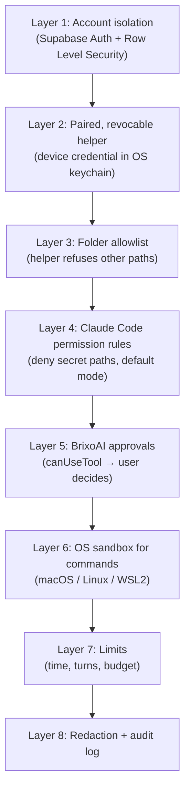

# BrixoAI — Security and Permissions (Planning v2)

**Status:** Proposed design. **No control described here is implemented**, and BrixoAI makes no security certification claims. This document extends the baseline in [../SECURITY.md](../SECURITY.md), which remains in force. Labels are explained in [PRODUCT.md](./PRODUCT.md).

## Why security comes first here

BrixoAI lets an AI run commands on a real person's computer. A mistake can delete files, leak secrets or push bad code. Our approach is **defence in depth**: several independent layers, so one failure is not a disaster.

---

## 1. Authentication and account isolation

- Users sign in with **Supabase Auth** (GitHub OAuth or email magic link — decision pending).
- **Row Level Security (RLS) is enabled on every table.** Policies check that `workspace_id` belongs to the signed-in user (single-user workspaces in the MVP).
- Server code re-checks ownership before any privileged action. It never trusts IDs sent from the browser without checking.
- Hidden or disabled buttons are **not** a security boundary.
- The Supabase **service role / secret key** exists only in Netlify server environment variables. It never goes to the browser, the helper or the repository.
- **Tests:** automated RLS tests with two users (user B cannot select, insert, update or delete user A's rows in any table), run against the local Supabase stack in CI.

## 2. Secure storage of API keys and OAuth tokens

| Secret | Where it lives | Never stored in |
|---|---|---|
| User's Anthropic API key | **User's OS keychain**, read by the helper and passed only to the Claude runtime child process via environment | BrixoAI database, browser, logs, repo files, chat |
| Helper device credential | OS keychain (helper side); **only a hash** in the `devices` table | Plain text anywhere |
| GitHub App private key, client secrets | Netlify environment variables (server only) | Repository, database, browser |
| Users' GitHub user tokens / Netlify tokens (M5, M8) | Encrypted at rest in a server-only table or Supabase Vault (Needs verification of Vault suitability), decrypted only in server code | Browser, helper, logs |
| Supabase anon/publishable key | Browser and helper (designed to be public; RLS protects data) | — |

Rules:
- `.env.example` contains **placeholders only**. Real `.env` files are git-ignored.
- **Never ask users to paste keys into chat, task prompts, planning documents or source files.** The UI shows where to put each secret.
- Encryption keys for stored tokens live in environment variables and can be rotated. The plan includes a re-encryption script.
- Disconnect = delete the stored token + revoke at the provider where possible.

## 3. Local helper pairing and connection security

**Pairing flow (device-code style, Proposed):**
1. The user runs `brixo-helper pair`. The helper requests a pairing from the server and receives a **short user code** (e.g. `KQ7M-2XRD`) plus a secret device code. Both expire in 10 minutes.
2. The helper shows the user code and a link. The user, **already signed in** on the web app, enters the code and sees the device name and operating system before clicking **Approve**.
3. The helper polls the server, rate-limited. After approval it receives a random **device credential**, stores it in the OS keychain, and the server stores only its hash.
4. The web app lists paired devices with last-seen time and a **Revoke** button. Revoking immediately blocks the credential and fails any of that device's running tasks.

**Connection security:**
- The helper opens **no network ports** and accepts no incoming connections. All traffic is outbound HTTPS/WSS to Supabase and the BrixoAI server.
- The device token used for Supabase should be **short-lived** and scoped to that device's rows (approach: unknown U1 in [ARCHITECTURE.md](./ARCHITECTURE.md#10-open-unknowns)).
- Pairing endpoints are rate-limited. Codes are single-use. The approval screen warns: *"Only approve a code you see on your own computer right now."* This counters phishing ("enter this code for me").
- The helper verifies TLS normally and never disables certificate checks.
- Helper releases are published from CI with provenance (npm provenance — Needs verification); signed desktop builds come Later.

## 4. Project-folder restrictions

- The helper keeps a local **allowlist** of absolute folder paths in its config file (in the user's config directory). The cloud only knows a project ID and a display name.
- The helper **refuses** tasks for projects with no local folder binding on that device.
- Path checks resolve symlinks (`realpath`) before comparing, to block `../` and symlink escapes.
- Claude runs with `cwd` set to the project folder. Claude Code's file tools treat the working directory as their scope. Writes outside it need approval (Verified behaviour of `acceptEdits` and `default` modes).
- **Deny rules for sensitive locations** are always added, e.g. home-directory SSH keys, cloud credentials, browser profiles, password-manager data, and the BrixoAI helper's own config and keychain access. Exact rule syntax to be verified in M1. Use `//` absolute anchors (Verified syntax note).
- The allowlist UI warns against adding the whole home directory or a system folder, and refuses `/`, `C:\` and the home directory itself.
- **Important limitation (Verified):** Claude Code's sandbox allows **reads across most of the machine by default**, and the built-in Read tool is not sandboxed. Read access to secrets must therefore be blocked with deny rules and `filesystem.denyRead` / credential settings, not assumed.

## 5. Terminal and browser permissions

**Terminal (MVP):**
- BrixoAI's default is Claude Code `permissionMode: 'default'`. **`bypassPermissions` is never offered in the MVP.**
- Safe read-only commands that Claude Code already treats as read-only run without prompts (Verified). Everything else goes to a BrixoAI approval card through `canUseTool`.
- Per-agent **pre-approved command patterns** (e.g. `Bash(npm test *)`) are allowed only as scoped rules. A bare `Bash` allow is not permitted, because it auto-approves all commands and skips the callback (Verified warning).
- **OS sandbox:** enable Claude Code's command sandbox with `failIfUnavailable: true` and `allowUnsandboxedCommands: false` (Verified settings). It isolates file writes to the working directory and routes network access through an allowlist proxy, on macOS (Seatbelt), Linux and WSL2 (bubblewrap). **Native Windows has no sandbox (Verified)**, so the helper either requires WSL2 or runs native Windows in a stricter mode where every non-read command needs approval (decision U8).
- **Network:** sandboxed commands start with an empty domain allowlist (Verified). BrixoAI proposes a default allowlist for package registries (npm, PyPI), with others needing approval.

**Browser automation (Long-term):** a separate sandboxed browser profile, never the user's main logged-in profile; a per-site allowlist; approval before logins, form submissions, purchases or downloads; screenshots of what the agent saw for review.

## 6. Approval of sensitive actions

| Action | Default policy |
|---|---|
| Reading files inside the project | Allowed |
| Editing files inside the project | Allowed by default once a task runs, shown live; agents may be set to "ask before edits" |
| Editing outside the project | **Approval** (and blocked entirely for denied paths) |
| Running commands not on the read-only/pre-approved list | **Approval** |
| Installing dependencies | **Approval** |
| Network access to non-allowlisted domains | **Approval** |
| `git commit` / branch (local) | **Approval** (M5) |
| `git push`, opening a PR | **Approval** every time (M5) |
| Merging a PR | **Not supported** by BrixoAI (user merges on GitHub) |
| Netlify preview deploy | **Approval** (M8) |
| Netlify production deploy | **Approval with explicit confirmation text** (M8) |
| Enabling a skill or MCP server | **Review screen + approval** (M6, M9) |
| Deleting files / `rm -rf` | **Approval**. Claude Code also refuses critical-path removals in every mode (Verified) |

Each approval card shows: the agent, the exact command or file path, a plain-English explanation, the risk level, and **Approve / Deny** (plus "always allow this exact command for this agent" for low-risk patterns). Each decision is written to `approval_requests` and `audit_log` with user, time and the exact payload approved. **A timeout counts as deny.**

## 7. Untrusted repository files, skills, websites and MCP tools

**Everything an agent reads is untrusted data, not instructions from the user.** This includes repository files, README instructions, code comments, issue text, web pages, MCP tool descriptions and outputs, and imported skills.

- **Critical, Verified finding:** with default Agent SDK options, or `claude -p`, Claude Code loads the project's `.claude/settings.json` **hooks**, connects servers in `.mcp.json`, and reads `CLAUDE.md` — **with no trust dialog**. A malicious repository could run commands through hooks the moment a task starts. **Mitigation:** the helper uses `settingSources: []` by default. A per-project **"Trust this project's Claude settings"** toggle shows exactly what would load (hooks, MCP servers, instructions). Even when trusted, hooks and MCP servers are listed for the user to review.
- Also disable auto memory for untrusted projects (`CLAUDE_CODE_DISABLE_AUTO_MEMORY=1` — Verified option) so content from one project cannot persist into others unexpectedly.
- **Prompt injection** (text that tries to trick the AI into harmful actions) cannot be fully prevented. The approval layer and sandbox are what limit the damage. The agent's system prompt states that file and web content are data, not commands.
- **Skills (M6):** imported skills are shown in full before enabling. They are versioned, and an agent pins a specific version. Changes require re-approval. Skills from GitHub are fetched as text only and never executed on import.
- **MCP (M9):** local (stdio) servers are treated like installing software: explicit install approval, with the command shown. Remote servers need OAuth consent. Tool calls require approval unless the user pre-approves specific tools.
- **Rendered content:** markdown from agents is sanitised before display (no raw HTML or scripts). Filenames and logs are escaped. A Content Security Policy is set on the web app.

## 8. Secret redaction and safe logging

- The helper **redacts before sending** anything to the cloud: known key formats (Anthropic, GitHub, AWS, Stripe, Supabase JWTs, private-key blocks), `.env`-style `KEY=value` lines for sensitive key names, plus high-entropy string detection. The redactor is a pure function in `packages/shared`, with a large unit-test corpus.
- **Events are summaries.** Example: "Ran `npm test` — exit code 1 — 3 failing tests". Output excerpts are capped (proposal: 8 KB per event), and full output stays local.
- The helper never sends the contents of `.env` files, keychain entries or files matching deny rules.
- Server logs: no request bodies containing tokens; structured logging with an allowlist of fields.
- The user can view exactly what was uploaded for any task (it is just the `task_events` rows).
- **Tests:** a redaction corpus test in CI; an end-to-end test that plants a fake secret in a project and asserts it never appears in the database.

## 9. Task cancellation, timeouts and failure recovery

- **Cancel:** sets `cancel_requested_at`. The helper calls the SDK's `interrupt()` (Verified), resolves pending approvals as deny, and force-stops the runtime after a 10-second grace period. Cancel is idempotent (clicking twice is harmless).
- **Limits (defaults proposed, per-agent overrides within hard caps):** 30-minute wall clock, 50 agent turns, a per-task estimated-cost cap, a 15-minute approval timeout, a 10-minute queue expiry.
- **Helper loss:** no heartbeat for 2 minutes → server marks running tasks `failed` (`helper_lost`).
- **No automatic whole-task retries** (to avoid repeated side effects). The user explicitly clicks **Run again**.
- **External side effects are idempotent where possible:** PR creation checks for an existing PR on the branch first; deploys record the deploy ID before reporting success.
- State changes are validated: transitions follow the state machine in [ARCHITECTURE.md](./ARCHITECTURE.md#41-task-states-canonical-list-used-across-all-planning-docs), enforced in a database function, not just the UI.

## 10. Safe deployment and GitHub permissions

- GitHub App with **minimum permissions** and user-selected repositories ([INTEGRATIONS.md](./INTEGRATIONS.md#2-github)). Installation tokens are short-lived (1 hour — Verified) and narrowed per request.
- Agents work on a **new branch**, never directly on the default branch. BrixoAI does not merge.
- Pushes, PRs and deploys need approval each time and are recorded in `audit_log` with the provider's response (PR number/URL, deploy ID).
- **Production deploys** require explicit confirmation. Preview deploys come first.
- The web app's own deployment: Netlify deploys from the `main` branch only after CI passes. Branch protection is on `main`. **Nothing is deployed to production without your explicit approval** (project rule in [../../CLAUDE.md](../../CLAUDE.md)).
- Dependencies: lockfile committed, Dependabot alerts, `npm audit` in CI, minimal dependencies.
- Open source: a `SECURITY.md` vulnerability-reporting policy at the repo root before public launch (Later).

---

## Must be implemented before testing with real users

This is a **gate**: no external tester touches BrixoAI until every item is done and verified.

- [ ] RLS on every table + passing two-user isolation tests.
- [ ] Service-role key server-only; secret scanning (GitHub secret scanning / pre-commit) enabled on the repo.
- [ ] Helper pairing with expiring single-use codes, hashed device credentials, a device list and working **Revoke**.
- [ ] Folder allowlist with symlink-safe checks; refusal of home/root folders.
- [ ] `settingSources: []` by default + the "trust this project" review flow.
- [ ] Deny rules for credential locations; sandbox enabled where available with `failIfUnavailable`; a documented Windows policy.
- [ ] `permissionMode: 'default'`, no `bypassPermissions`, no bare `Bash` allow; approvals via `canUseTool` with timeout = deny.
- [ ] Cancel, time, turn and budget limits working and tested.
- [ ] Redaction in the helper with a test corpus + the planted-secret end-to-end test passing.
- [ ] Sanitised markdown rendering and a Content Security Policy.
- [ ] Anthropic API key never leaves the user's machine (verified by inspecting network traffic and database contents in a test run).
- [ ] Audit log entries for approvals.
- [ ] A plain-English risk notice in onboarding: what the agent can do on your computer, and how to stop it.
- [ ] Rate limiting on pairing and task-creation endpoints.
